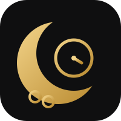
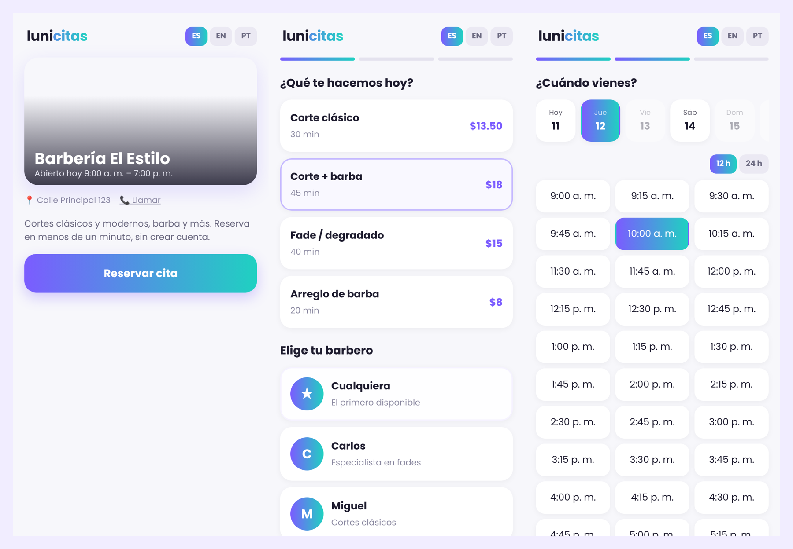
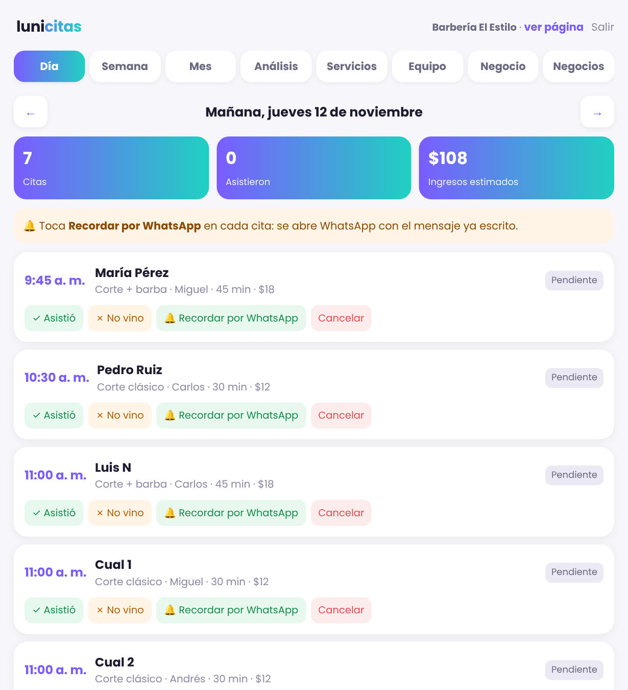
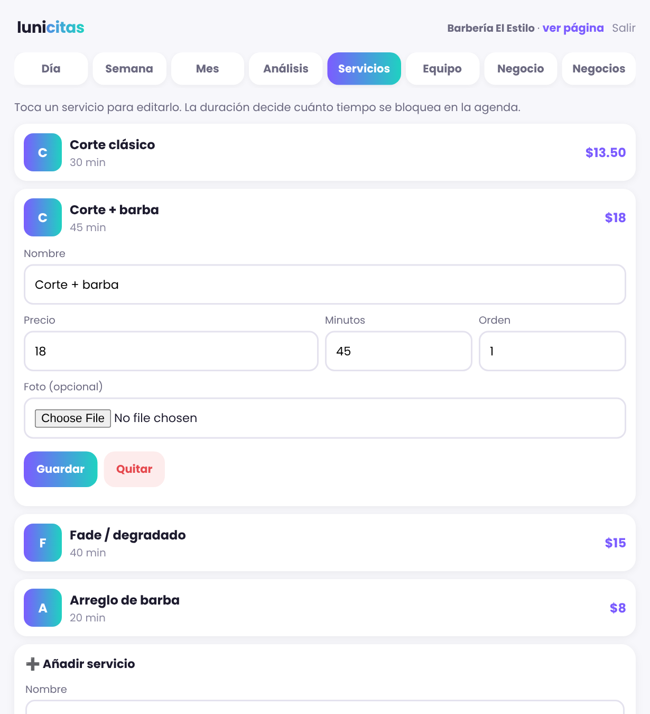

<p align="center"></p>

<p align="center"><b>Reservas de citas, de código abierto, para barberías, salones de belleza y centros de estética.</b><br>
Sencilla, bonita y pensada para el celular. En español, inglés y portugués.</p>

<p align="center">
  <a href="https://www.hostinger.com/deploy?template=luisnieves10/lunicitas"></a>
</p>

<p align="center"><a href="https://lunicitas.com">Ver demo en vivo</a> · <a href="#instalar-en-2-minutos">Instalar</a> · <a href="#english">English</a></p>



## ¿Qué hace?

**Para tus clientes**
- Reservan en menos de un minuto, sin crear cuenta: servicio, persona, día y hora.
- Solo ven horas realmente libres: la app tiene en cuenta la duración de cada servicio, el horario, el descanso del almuerzo y los días libres.
- Opción “Cualquiera”: la app asigna a quien esté libre.
- Español, inglés y portugués, con horario de 12 o 24 horas.

**Para el dueño** (portal en `admin.php`)
- Agenda por día, semana y mes. Marca quién asistió y quién no.
- 🔔 Recordatorio por WhatsApp en un toque, con el mensaje ya escrito. Opcional: recordatorios automáticos.
- Servicios editables: nombre, precio, duración y foto.
- Equipo editable: nombres, fotos y especialidades.
- Horario por día, descansos y días libres (de todo el negocio o de una sola persona).
- Análisis del mes con gráficas, comparación con el mes anterior y descarga a Excel o PDF.
- Tipo de negocio: barbería, salón de belleza o estética. Los textos se adaptan (barbero, estilista, especialista).

**Planes y registro (para ofrecerla como servicio)**
- Página `registro.php`: cualquier negocio crea su cuenta solo, con 3 días de prueba con todo incluido y sin tarjeta (`LC_DIAS_PRUEBA` en `lib.php`).
- Plan **Pro** con todo. Al terminar la prueba, si el negocio no añadió su tarjeta, la cuenta se cierra: el dueño solo ve la pantalla de pago y su página deja de aceptar reservas. Al pagar, todo vuelve como estaba.
- La página principal (`inicio.php`) presenta la app y lleva al registro cuando el registro está abierto; si no, muestra tu página de reservas.
- Cobro mensual con **Stripe**, listo para activar: pago, renovación, cancelación y avisos automáticos (`stripe.php`).
- Desde la pestaña Negocios abres o cierras el registro público y cambias el plan de cualquier negocio a mano.

**Varios negocios en una sola instalación.** Cada uno con su enlace (`tudominio.com/mi-barberia`) y sus datos separados. Ideal para ofrecer LuniCitas como servicio.



## Instalar en 2 minutos

Necesitas un hosting con PHP 7.4 o superior y MySQL (cualquier plan de Hostinger sirve).

1. **Crea una base de datos.** En Hostinger: hPanel → Bases de datos → *Nueva base de datos MySQL*. Anota el nombre, el usuario y la contraseña.
2. **Sube los archivos.** Lo más fácil: hPanel → Avanzado → *Git* → repositorio `https://github.com/luisnieves10/lunicitas`, rama `main`, carpeta `public_html`. También puedes descargar el ZIP y subirlo con el Administrador de archivos.
3. **Abre tu dominio.** Te llevará solo a `install.php`. Escribe los datos de la base de datos, el nombre de tu negocio y tu usuario del portal.
4. ¡Listo! Comparte tu enlace de reservas y entra al portal en `tudominio.com/admin.php`.

El instalador guarda `config.php` fuera de `public_html` cuando puede, para que nadie lo vea desde el navegador.

### Actualizar

Si instalaste desde Git, cada actualización llega con un *pull* (o sola, si activaste el despliegue automático). La base de datos se actualiza sola la primera vez que se abre la app; tus citas no se tocan.

### Cobrar con Stripe (opcional)

1. Crea tu cuenta en [stripe.com](https://dashboard.stripe.com/register) y, para probar, un [sandbox](https://docs.stripe.com/sandboxes). Crea un producto “LuniCitas Pro” con precio mensual y copia su ID (`price_…`).
2. En Desarrolladores → Claves de API, crea una **clave restringida** (`rk_…`), más segura que la secreta: escritura en *Checkout Sessions*, *Customer portal*, *Customers* y *Subscriptions*; lectura en *Charges*.
3. En Desarrolladores → Webhooks, añade `https://TU-DOMINIO/stripe.php` con los eventos `checkout.session.completed`, `customer.subscription.created`, `customer.subscription.updated`, `customer.subscription.deleted`, `invoice.paid`, `invoice.payment_failed`, `charge.dispute.created` y `radar.early_fraud_warning.created`. Copia el secreto (`whsec_…`).
4. Añade a `config.php` (nunca lo subas a GitHub):
   ```php
   $STRIPE_SECRET = 'rk_test_…';
   $STRIPE_PRICE = 'price_…';
   $STRIPE_WEBHOOK_SECRET = 'whsec_…';
   $PLAN_PRECIO = '$20 al mes';
   ```
5. Prueba con la tarjeta `4242 4242 4242 4242`. Cuando todo funcione, repite los pasos 2 y 3 en modo real (`rk_live_…` y un webhook real con su propio secreto).

Cómo funciona: si un negocio en prueba pasa a Pro, no se le cobra hasta que termine la prueba. Si un cobro falla, sigue en Pro mientras Stripe reintenta y el portal le pide actualizar la tarjeta. Cada aviso de Stripe se comprueba con su firma y se vuelve a consultar la suscripción, así que da igual si llegan repetidos o desordenados. En Stripe → Configuración → Facturación, activa los *Smart Retries* y los correos de pago fallido. Los negocios cancelan desde **Plan → Cancelar suscripción** (no se les vuelve a cobrar y conservan Pro hasta el fin del periodo pagado).

Las instalaciones nuevas empiezan con el registro público cerrado y todos los negocios en Pro: si la usas solo para tu negocio, no tienes que configurar nada de esto.

### Recordatorios automáticos por WhatsApp (opcional)

El botón **Recordar por WhatsApp** del portal funciona sin configurar nada. Si además quieres que salgan solos el día antes:

1. Crea una app en [Meta for Developers](https://developers.facebook.com/) con WhatsApp Cloud API y una plantilla aprobada llamada `recordatorio_cita` con 4 variables: nombre, negocio, fecha y hora, servicio.
2. Añade a `config.php`:
   ```php
   $WA_TOKEN = 'tu token';
   $WA_PHONE_ID = 'id de tu número';
   ```
3. En hPanel → Avanzado → *Cron Jobs*, programa cada hora:
   `php /home/USUARIO/domains/TU-DOMINIO/public_html/recordatorios.php`

## Archivos

| Archivo | Qué hace |
|---|---|
| `index.html` | Página de reservas de cada negocio |
| `api.php` | Horas libres y nuevas reservas |
| `admin.php` | Portal del dueño |
| `install.php` | Instalador |
| `lib.php` | Funciones compartidas y actualización de la base de datos |
| `registro.php` | Registro de negocios nuevos con prueba gratis |
| `stripe.php` | Recibe los avisos de pago de Stripe |
| `legal.php` | Términos y condiciones y Política de privacidad (pon tus datos en `config.php`: `$LEGAL_NOMBRE`, `$LEGAL_EMAIL`, `$LEGAL_LUGAR`) |
| `recordatorios.php` | Recordatorios automáticos (opcional, por cron) |



## Contribuir

¡Las ideas y mejoras son bienvenidas! Abre un *issue* o un *pull request*. Próximas ideas: depósitos en línea, programa de lealtad y reseñas.

## Licencia

[AGPL-3.0](LICENSE). Puedes usarla, modificarla e instalarla gratis. Si ofreces una versión modificada como servicio en línea, debes publicar tus cambios.

---

### English

**LuniCitas** is an open-source booking app for barbershops, beauty salons and spas. Customers book in under a minute without an account (English, Spanish and Portuguese). Owners manage services, staff, hours, days off, attendance, WhatsApp reminders and monthly analytics. One install can host many businesses, each with its own link. Install: create a MySQL database, upload the files (or deploy from Git) and open your domain to run `install.php`. Licensed under AGPL-3.0.
